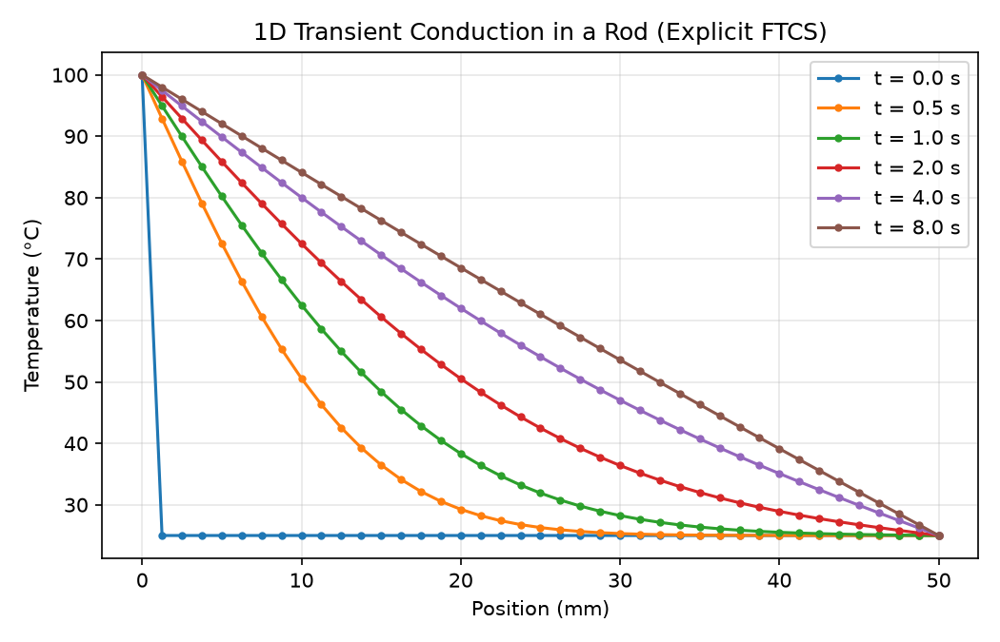

# Heat conduction Simulator 
A python implementation of 1D heat conduction built to visualize and learn the numerical methods used in transport phenomena

## Usage
- This simulator solves the 1D transient heat equation using finite differences and then animates the transformation
- Then this simulator compares the numerical results against an exact solution found through Fourier series, whih has a <.02 degC error
- Finally, this simulator extends the concepts to a two-layer composite wall with convective boundary conditions on both sides

## Why
I built this to develope a working understanding of the numerical methods used in computational transport phenomena so I can join a lab. Additionally, this was done through curiosity after learning of the Fourier series in my Differential Equations class.

## Running the simulator
'''
pip install -r requirements.txt
python step1_explicit.py
python step2_validation.py
python step3-multilayer.py
'''

## Results

The code comments include governing equations and defined variables.

echo "# heat-conduction-sim" >> README.md
git init
git add README.md
git commit -m "first commit"
git branch -M main
git remote add origin https://github.com/DiegoF903/heat-conduction-sim.git
git push -u origin main
